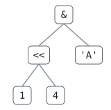

**English** · [한국어](README.ko.md)

[← Previous: 16. Trees and Recursion](../16-trees-steps/README.md) · [Contents](../../README.md)

# 17. Drawing a Tree — SVG from TypeScript

> Series: DH.Study.TypeScript · Lesson 17 (Part 3)
> Environment: Node.js v24 · TypeScript 7 · Vitest 5 · VS Code · a browser

## Goals

After this lesson you can:

- [ ] Place every node of a tree with a simple rule (leaves take the next slot, a parent sits in the middle of its children), and keep the layout apart from the drawing
- [ ] Read and write basic SVG: `viewBox`, `line`, `rect`, `text`, `g` with `transform`, `title`, `style`
- [ ] Escape text for markup in the right order, and say why `textContent` needs no escaping
- [ ] Create SVG elements from code with `createElementNS`, and type a helper with `SVGElementTagNameMap`
- [ ] Style SVG with CSS variables (`fill`, `stroke`), and make a drawing readable to a screen reader (`role="img"`, `<title>`, `aria-current`)
- [ ] Show DevCalc's tree: `--tree` on the command line, a Tree panel on the page that follows the step you pick

## Contents

1. [Coordinates before pixels](#1-coordinates-before-pixels)
2. [SVG is text](#2-svg-is-text)
3. [SVG in the DOM](#3-svg-in-the-dom)
4. [Try it](#4-try-it)
5. [DevCalc step — Lv12 tree view](#5-devcalc-step--lv12-tree-view)
6. [Summary](#summary)
7. [Where next](#where-next)

Example files for this lesson: [layout.ts](layout.ts) · [svg.ts](svg.ts) · [svgdom.ts](svgdom.ts) (browser, [index.html](index.html))

> Each example has a Korean-comment twin (`x.ko.ts`) with the same code. The Korean lesson ([README.ko.md](README.ko.md)) uses those.

> Syntax tags: **[JS]** = JavaScript syntax (exists without TS) · **[TS]** = type syntax that TypeScript adds (erase it and you get JS) · details in [lesson 00, 7-3](../00-setup/README.md#7-3-ts-syntax--js-syntax--type-syntax)

Lesson 16 printed the tree with `├─` and `└─`, sideways, one node per line. That is fine for a terminal, but a tree is a picture: the root on top, the children below, lines between them. This lesson draws it, first as text, then as SVG, and puts it on DevCalc's page next to the Steps:



(That image is [tree.svg](tree.svg), written by [svg.ts](svg.ts) in section 2.)

---

## 1. Coordinates before pixels

Drawing a tree is two jobs: **where** each box goes (the layout), and **how** it looks (the drawing). Keeping them apart means one layout can be drawn many ways: with characters in a terminal, with SVG on a page, at any size.

### 1-1. The rule

- **y** is the depth: the root is level 0, its children level 1, and so on.
- **x** comes from the leaves: each leaf takes the next free slot (0, 1, 2, …) from left to right, so two leaves never overlap.
- A **parent** sits in the middle of its first and last child, so it is always above them.

[layout.ts](layout.ts) writes the rule out as one recursive walk, children first:

```ts
function Layout(oRoot: TNode): IBox[] {
	const arrBox: IBox[] = [];
	let nNextLeaf = 0;
	function Place(oNode: TNode, nY: number): number {
		const arrChild = NodeChildren(oNode).map((oChild) => Place(oChild, nY + 1));
		let nX = nNextLeaf;
		if (arrChild.length === 0) {
			nNextLeaf += 1; // a leaf : the next free slot
		} else {
			const arrChildX = arrChild.map((nChild) => arrBox[nChild]?.nX ?? 0);
			nX = (Math.min(...arrChildX) + Math.max(...arrChildX)) / 2; // a parent : the middle of its children
		}
		arrBox.push({ strLabel: NodeLabel(oNode), nX, nY, arrChild });
		return arrBox.length - 1;
	}
	Place(oRoot, 0);
	return arrBox;
}
```

- **[JS]** The children are placed **before** their parent: the post-order walk from lesson 16. A parent needs its children's x, so it has to wait for them.
- **[JS]** `nNextLeaf` lives outside `Place` and every call shares it: a closure (lesson 13). That counter is the whole trick: it hands out slots in the order the leaves are met.
- `arrChild` holds **indexes** into `arrBox`, not objects: the list is flat, and a drawer can loop over it once for the lines and once for the boxes.

```
1) 1 + 2 * 3
   #  label  x     y  children
   0  1      0     1  []
   1  2      1     2  []
   2  3      2     2  []
   3  *      1.5   1  [1, 2]
   4  +      0.75  0  [0, 3]
```

`*` sits at 1.5, between `2` (1) and `3` (2). `+` sits at 0.75, between `1` (0) and `*` (1.5). The coordinates are in slots and levels, not pixels: the drawer decides how big a slot is.

`NodeLabel` and `NodeChildren` come from DevCalc's new `devcalc/src/core/Tree.ts`: the `Label` and `Children` of lesson 16, moved into the core so both the command line and the page use them.

### 1-2. Any drawer: a picture made of characters

To check the coordinates, `Picture()` puts each label on a grid of characters: one slot = 6 columns, one level = 2 lines (one for the boxes, one for the edges). An edge is `/`, `\` or `|`, depending on where the child is.

```
2) 10 + 30 * (100 + 2) / 10 + 20
                        [+]
                    /          \
              [+]                 [20]
           /       \
    [10]              [/]
                    /      \
                [*]         [10]
               /   \
          [30]      [+]
                    /  \
                [100]  [2]
```

Compare it with lesson 16's sideways tree of the same expression: the same nodes, now standing up. The labels are in `[ ]` so that the operator `/` is not taken for an edge.

```
3) same places as LayoutTree : true · 6 slots × 6 levels
   in pixels (a slot 48 wide, a level 58 high) : 288 × 316
   x = in-order position instead : 11 columns
```

- DevCalc's `LayoutTree()` gives the same places, and also returns `nWidth` (the number of leaf slots) and `nHeight` (the number of levels): exactly what a drawer needs to size its picture.
- Another rule that never overlaps: give every node its own column, x = its position in the in-order walk (lesson 16). It is simpler, but every operator takes a column, so the tree is almost twice as wide (11 columns instead of 6).

### 1-3. The middle of nothing

```
4) Expected problem: a leaf placed like a parent → x = NaN
   Why : Math.min() of nothing is Infinity, Math.max() of nothing is -Infinity. Infinity + -Infinity is NaN, and no error is thrown.
   Fix : handle the base case first : a leaf takes the next free slot (the if in Place).
```

**[JS]** `Math.min()` and `Math.max()` with no arguments do not throw: they return `Infinity` and `-Infinity` (the values that lose against any number). Their average is `NaN`, and `NaN` would quietly travel into every coordinate and the SVG would draw nothing. The `if` for leaves is the base case of the recursion, and here it is also what keeps the numbers finite.

---

## 2. SVG is text

**SVG** (Scalable Vector Graphics) describes a picture with tags, the way HTML describes a page. It scales without blurring, it can be styled with CSS, and it can be written by any program that can write text. [svg.ts](svg.ts) writes the tree of `(1 << 4) & 'A'` with no browser at all:

```
1) (1 << 4) & 'A'
   1    → 1
   4    → 4
   <<   → &lt;&lt;
   'A'  → &#39;A&#39;
   &    → &amp;
2) 1256 characters :
   <svg xmlns="http://www.w3.org/2000/svg" viewBox="0 0 160 158" width="160" height="158" role="img">
     <title>Tree of (1 &lt;&lt; 4) &amp; &#39;A&#39;</title>
     <style>
       line { stroke: #8c959f; stroke-width: 1.5 } rect { fill: #ffffff; stroke: #59636e }
       text { fill: #1f2328; font: 14px ui-monospace, Consolas, monospace; text-anchor: middle; dominant-baseline: central }
       @media (prefers-color-scheme: dark) { rect { fill: #0d1117; stroke: #9198a1 } text { fill: #e6edf3 } line { stroke: #656c76 } }
     </style>
     <line x1="56" y1="92" x2="32" y2="124"/>
     <line x1="56" y1="92" x2="80" y2="124"/>
     <line x1="92" y1="34" x2="56" y2="66"/>
     <line x1="92" y1="34" x2="128" y2="66"/>
     <g transform="translate(32 137)"><rect x="-13" y="-13" width="26" height="26" rx="5"/><text>1</text></g>
     <g transform="translate(80 137)"><rect x="-13" y="-13" width="26" height="26" rx="5"/><text>4</text></g>
     <g transform="translate(56 79)"><rect x="-15.5" y="-13" width="31" height="26" rx="5"/><text>&lt;&lt;</text></g>
     <g transform="translate(128 79)"><rect x="-19.5" y="-13" width="39" height="26" rx="5"/><text>&#39;A&#39;</text></g>
     <g transform="translate(92 21)"><rect x="-13" y="-13" width="26" height="26" rx="5"/><text>&amp;</text></g>
   </svg>
```

### 2-1. The tags in this picture

| Part | What it does |
|---|---|
| `xmlns="http://www.w3.org/2000/svg"` | says "these are SVG tags". A `.svg` file needs it; inside an HTML page the `<svg>` tag sets it by itself |
| `viewBox="0 0 160 158"` | the drawing's own coordinates: x from 0 to 160, y from 0 to 158, **y grows downwards**. `width`/`height` are the size on screen; when they differ, the drawing is scaled |
| `<line x1 y1 x2 y2>` | a straight line between two points. The lines come first: later tags are drawn on top, so the boxes cover the ends of the lines |
| `<g transform="translate(x y)">` | a group whose (0, 0) is moved to (x, y). Each box is drawn around its own centre, so the rect is always at `-width/2, -13` |
| `<rect x y width height rx>` | a rectangle; `rx` rounds the corners |
| `<text>` | text; `text-anchor: middle` and `dominant-baseline: central` centre it on (0, 0) |
| `<title>` | the drawing's name. With `role="img"` a screen reader reads it, and a browser shows it as a tooltip |
| `<style>` | CSS inside the picture. SVG uses `fill` (inside) and `stroke` (outline) instead of `background` and `border` |

The `@media (prefers-color-scheme: dark)` rule is why the picture at the top of this lesson follows a dark theme too, even when it is shown with `` (which can't see the page's CSS).

The box width comes from the label length (`8.4` pixels per character of a 14 px monospace font, plus some room). It is an estimate: a browser could measure the text exactly (`getBBox()`), but a file written in Node has no font to measure with, and for short labels the estimate is enough.

### 2-2. Escaping: & first

The labels go **inside** markup, and `<<`, `&` and `'` mean something there. They have to be written as entities (`&lt;`, `&amp;`, `&#39;`):

```ts
function Escape(strText: string): string {
	return strText.replaceAll("&", "&amp;").replaceAll("<", "&lt;").replaceAll(">", "&gt;").replaceAll('"', "&quot;").replaceAll("'", "&#39;");
}
```

```
3) Expected problem: "<<" escaped with & last → &amp;lt;&amp;lt; (the page shows &lt;&lt; instead of <<)
   Why : &lt; was made first, then its & was escaped again into &amp;lt;.
   Fix : escape & first, as Escape() does. In the browser, textContent does all of this for you.
```

**[JS]** Every entity starts with `&`. If `&` is replaced last, it also replaces the `&` of the entities made a moment ago, and the reader sees `&lt;` as text. Without any escaping it is worse: `<<` starts a tag, and the file is broken. DevCalc labels are user input (`'A'`, variable names), so this is the same rule as lesson 07's "never `innerHTML` with user text", seen from the other side.

### 2-3. Saving the file

```
> node lessons/17-tree-view/svg.ts lessons/17-tree-view/tree.svg
…
4) saved : lessons/17-tree-view/tree.svg (open it in a browser, or show it with )
```

**[JS]** `writeFileSync(strFile, strSvg, "utf8")` writes the file itself. Redirecting the printed markup with `>` would also work in some shells, but Windows PowerShell 5 writes UTF-16 by default, and a `.svg` file is expected to be UTF-8.

---

## 3. SVG in the DOM

A page can also build the SVG with DOM calls: no markup text, no escaping. [svgdom.ts](svgdom.ts) runs in the browser:

```
> npm run web
→ http://127.0.0.1:5173/lessons/17-tree-view/      (add ?ko for svgdom.ko.ts)
```

In Node it only explains where to open it:

```
> node lessons/17-tree-view/svgdom.ts
This example runs in the browser (it uses document).
  npm run web  →  http://127.0.0.1:5173/lessons/17-tree-view/
```

The log on the page:

```
1) Expected problem: createElement("rect") → HTMLUnknownElement, instanceof SVGRectElement = false
   namespaceURI = http://www.w3.org/1999/xhtml
   Why : the tag name alone does not say SVG. createElement always makes HTML elements, and the browser ignores an HTML <rect> inside <svg>.
   Fix : createElementNS("http://www.w3.org/2000/svg", "rect"). Markup text (innerHTML, a .svg file) gets the namespace from <svg>.
   createElementNS → SVGRectElement, instanceof SVGRectElement = true
   namespaceURI = http://www.w3.org/2000/svg
2) Svg("line") : x1 attribute = "100" (string), x1.baseVal.value = 100 (number)
3) textContent = "<<" (2 characters) · markup = <text x="44" y="24" text-anchor="middle">&lt;&lt;</text>
4) y = (1 << 4) & 'A' : 6 boxes, 5 lines, 160 × 216 px
   title = "Tree of y = (1 << 4) & 'A'" · the labels : 1 4 << 'A' & y =
```

### 3-1. The namespace

**[JS]** `document.createElement("rect")` makes an **HTML** element named `rect`. HTML has no such tag, so it is an `HTMLUnknownElement`: it can sit inside an `<svg>`, but it draws nothing and no error says why. SVG elements live in their own **namespace**, named by a URI, and must be made with `createElementNS(SVG_NS, "rect")`. (The URI is only a name: nothing is downloaded from it.)

### 3-2. A typed helper: SVGElementTagNameMap

```ts
function Svg<K extends keyof SVGElementTagNameMap>(strTag: K, oAttr: Readonly<Record<string, string | number>> = {}): SVGElementTagNameMap[K] {
	const elNew = document.createElementNS(SVG_NS, strTag);
	for (const [strName, vValue] of Object.entries(oAttr)) {
		elNew.setAttribute(strName, String(vValue));
	}
	return elNew;
}
```

**[TS]** The DOM types include an interface that maps each SVG tag name to its element type: `SVGElementTagNameMap` (`"line"` → `SVGLineElement`, `"rect"` → `SVGRectElement`, …). `K extends keyof …` makes `K` the tag name as a literal type, and `SVGElementTagNameMap[K]` looks the element type up (an indexed access type, lesson 08). So `Svg("line")` is an `SVGLineElement`, with no `as`, and a wrong tag name like `Svg("lin")` is a compile error. `document.createElementNS` itself is typed the same way for the SVG namespace, which is why the return needs no cast.

```ts
// elLine.cx; // ← Uncomment → red squiggle TS2339 (Property 'cx' does not exist on type 'SVGLineElement')
```

### 3-3. Attributes are text, properties are numbers

`setAttribute("x1", "100")` stores text. **[JS]** The element's property `elLine.x1.baseVal.value` reads it back as a number (an `SVGAnimatedLength`: SVG lengths can be animated, and `baseVal` is the value without animation). Writing attributes is the usual way; the properties are handy for reading.

### 3-4. textContent is already safe

`elText.textContent = "<<"` puts in two characters, not markup. When the element is serialized (`outerHTML`) the browser writes the entities itself: `&lt;&lt;`. So the DOM way needs no `Escape()`: the same rule as lesson 07, and the reason DevCalc's tree view uses only `textContent`.

### 3-5. A name for the picture

A drawing is just shapes to a screen reader. `role="img"` on the `<svg>` says "this is one image", and the first child `<title>` gives it a name ("Tree of y = …"). The page's styles reach inside the inline `<svg>` too: [index.html](index.html) colours the lines, boxes and text with the same CSS variables as the rest of the page, so the dark theme needs nothing more.

---

## 4. Try it

```
> node lessons/17-tree-view/layout.ts
1) 1 + 2 * 3
   #  label  x     y  children
   0  1      0     1  []
   1  2      1     2  []
   2  3      2     2  []
   3  *      1.5   1  [1, 2]
   4  +      0.75  0  [0, 3]
2) 10 + 30 * (100 + 2) / 10 + 20
                        [+]
                    /          \
              [+]                 [20]
           /       \
    [10]              [/]
                    /      \
                [*]         [10]
               /   \
          [30]      [+]
                    /  \
                [100]  [2]
3) same places as LayoutTree : true · 6 slots × 6 levels
   in pixels (a slot 48 wide, a level 58 high) : 288 × 316
   x = in-order position instead : 11 columns
4) Expected problem: a leaf placed like a parent → x = NaN
   Why : Math.min() of nothing is Infinity, Math.max() of nothing is -Infinity. Infinity + -Infinity is NaN, and no error is thrown.
   Fix : handle the base case first : a leaf takes the next free slot (the if in Place).
```

```
> node lessons/17-tree-view/svg.ts
1) (1 << 4) & 'A'
   …  (section 2)
3) Expected problem: "<<" escaped with & last → &amp;lt;&amp;lt; (the page shows &lt;&lt; instead of <<)
   Why : &lt; was made first, then its & was escaped again into &amp;lt;.
   Fix : escape & first, as Escape() does. In the browser, textContent does all of this for you.
4) Add a file name to save it : node lessons/17-tree-view/svg.ts tree.svg
```

For svgdom.ts: `npm run web`, then open `http://127.0.0.1:5173/lessons/17-tree-view/` (section 3 shows the log).

Things to try:

- In layout.ts, change `SMALL` to `max(1, 2, 3) - 4` → `max()` has three children and sits above the middle one (x = 1); `-` sits at 2, between `max()` (1) and `4` (3).
- In layout.ts, remove the `if (arrChild.length === 0)` branch so every node is placed like a parent → section 1 prints `NaN` everywhere, and nothing throws.
- In svg.ts, swap `Escape` for `EscapeWrongOrder` in `ToSvg`, save the file and open it in a browser → the boxes show `&lt;&lt;` and `&amp;`.
- In svg.ts, change `width="${nWidth}"` to `width="${nWidth * 3}"` (and the height the same way) → the picture is three times bigger and still sharp: the `viewBox` did not change, only the size on screen.
- In svgdom.ts, uncomment `elLine.cx;` → TS2339. Then change `Svg("line", …)` to `Svg("circle", …)` → the squiggle goes away (`cx` is the centre of a circle), and `elLine.x1` gets one instead.

---

## 5. DevCalc step — Lv12 tree view

```
> node devcalc/src/main.ts "(1 << 4) & 'A'" --tree
Tree :
  &
  ├─ <<
  │  ├─ 1
  │  └─ 4
  └─ 'A'
HEX : 0x0
DEC : 0
BIN : 0b0
```

On the page, the Tree panel draws the same tree under the Steps panel. Every line of Steps is now a button: pick a step and the tree shows that moment of the calculation.

| Step 1 of 4 | Step 3 of 4 |
|---|---|
| `+` highlighted: it is calculated next. Nothing is done yet | `40` and `240` are done (blue, with their values), the parts under them are faded; `*` is next |

(The expression is `y = (10 + 30) * max(0xF0, 'A') >> 2`.)

### What changed

| File | Change |
|---|---|
| `devcalc/src/core/Tree.ts` | new: `NodeLabel()`, `NodeChildren()` (lesson 16's `Label`/`Children`), `LayoutTree()` → `ITreeLayout` (`arrBox` in post-order, `nWidth`, `nHeight`), `TreeLines()` (the `├─ └─` text) |
| `devcalc/src/core/Steps.ts` | `IStep` gets `oNode` (the node of the step) and `biValue`; `IExplanation` gets `oRoot` |
| `devcalc/src/core/index.ts` | exports `LayoutTree`, `TreeLines`, `NodeLabel`, `NodeChildren`, `ITreeLayout`, `ITreeBox` |
| `devcalc/src/main.ts` | `--tree`: prints the tree before the result (also when the calculation then fails) |
| `devcalc/web/TreeView.ts` | new: `CTreeView.Show(oLayout, arrStep, nAt, strExpr)` draws the SVG for step `nAt` |
| `devcalc/web/App.ts` | each step line is a `<button data-step>`; `ShowExplanation()` makes the layout once, `ShowTree(nAt)` draws a step; one click listener on the list |
| `devcalc/web/index.html` | Tree panel (`<details id="tree-box">`), title `Lv12` |
| `devcalc/web/style.css` | step buttons and `[aria-current="step"]`; the tree's `line`, `rect`, `text`, `.focus`, `.done`, `.faded` |
| `devcalc/tests/Tree.test.ts` | new: 6 tests |
| `devcalc/tests/Web.test.ts` | App.ts may import `./TreeView.ts`; TreeView.ts imports only core types |

The core is still free of the DOM: `LayoutTree` returns slots and levels, and only `web/TreeView.ts` turns them into pixels.

### The page

`CTreeView.Show` draws the whole tree again for the step picked (`nAt`):

- **done**: the steps before `nAt`. Their box shows the value instead of the label (`40` instead of `+`). It uses the same idea as lesson 16's `Map` keyed by nodes: `IStep.oNode` is the very node object in the layout, so `new Map(arrStep.slice(0, nAt).map((oStep) => [oStep.oNode, oStep.biValue]))` is enough.
- **focus**: `arrStep[nAt].oNode`, the part calculated next (the same part Steps highlights in `<mark>`).
- **faded**: everything under a done box. `arrBox` is in post-order (the root last), so a loop **backwards** meets every parent before its children and can pass "faded" down in one go.
- `nAt = arrStep.length` (the last line, the result) shows everything done.

```ts
// devcalc/web/TreeView.ts
for (let nIndex = arrBox.length - 1; nIndex >= 0; nIndex--) {
	const oBox = arrBox[nIndex];
	const bHide = (arrFaded[nIndex] ?? false) || (oBox !== undefined && mapDone.has(oBox.oNode));
	for (const nChild of oBox?.arrChild ?? []) {
		arrFaded[nChild] = bHide;
	}
}
```

The states are only CSS classes on each `<g>` (`done`, `focus`, `faded`); the colours are in style.css, with the page's variables:

```css
.tree .focus rect {
	fill: var(--mark);
	stroke: var(--fg);
	stroke-width: 2;
}
.tree .done rect {
	fill: var(--panel);
	stroke: var(--accent);
	stroke-width: 2;
}
.tree .faded {
	opacity: 0.3;
}
```

Picking a step:

```ts
// devcalc/web/App.ts
elSteps.addEventListener("click", (oEvent) => {
	const elButton = oEvent.target instanceof Element ? oEvent.target.closest<HTMLButtonElement>("button[data-step]") : null;
	if (elButton?.dataset.step !== undefined) {
		ShowTree(Number(elButton.dataset.step));
	}
});
```

- One listener for all the lines (event delegation, lesson 14). The lines are made again for every expression, so listeners on each button would have to be added again each time.
- They are `<button>`s, so Tab reaches them and Enter or Space picks them, with no key code of our own (lesson 14).
- **[JS + TS]** `ShowTree` sets `aria-current="step"` on the picked line and removes it from the others. A screen reader announces "current step", and the CSS styles `[aria-current="step"]`: the attribute is the one place the state lives. The value matters: an empty `aria-current=""` means *false*.
- `TreeView.ts` imports only types from the core (`import type { IStep, ITreeLayout }`). They are erased, so the file adds nothing to the bundle but its own code; a test keeps it that way.
- The layout is made once per expression (`ShowExplanation`); picking a step only draws again.

### Tests

`devcalc/tests/Tree.test.ts` checks: the label and children of every kind of node (`y = -x * max(0xF0, 'A') + ans`); the places for `1 + 2 * 3` (`1@0,1 2@1,2 3@2,2 *@1.5,1 +@0.75,0`); a single child straight below its parent (`-(~5)`); no two boxes in one place for the lesson 16 example (6 × 6); that the steps point at nodes of the layout; `TreeLines`; and `--tree`, also when the calculation fails (`1 / 0` prints the tree, then the error, exit code 1).

```
> npm test
check-pairs : 76 pairs, 0 failed
check-names : 41 files, 0 problems

 Test Files  14 passed (14)
      Tests  95 passed (95)
```

### Checked

The page was opened in a headless browser, both through the local server and as the single file `DevCalc.html` (`npm run build:single`): the title is `DevCalc Lv12 · web`; for `y = (10 + 30) * max(0xF0, 'A') >> 2` the tree has 10 boxes, step 1 highlights `+`, step 3 shows `40` and `240` done, the four leaves under them faded, and `*` highlighted. Before the first expression, the panel shows only its note. The lesson page draws the same way with `?ko`.

Things to try:

- `node devcalc/src/main.ts "y = -x * max(0xF0, 'A') + 1" --tree` → the tree is printed, then `Invalid input: "x"`: the parser does not need to know `x`, the calculation does.
- On the page, enter `(1 + 1) * (1 + 1)` and pick step 2 → only the **right** `+` is highlighted, the left one is already `2`: the `Map` keyed by nodes from lesson 16, now visible.
- On the page, press Tab until a Steps line is focused, then Enter → the tree follows.

---

## Summary

- Drawing is two jobs: the **layout** (slots and levels) and the **drawing** (pixels, characters). One layout, many drawers.
- **[JS]** Leaves take the next slot from a shared counter (a closure), a parent sits in the middle of its children: one post-order walk. `Math.min()` of nothing is `Infinity`, so the leaf case comes first.
- **[JS]** SVG is text: `viewBox` (y grows downwards), `line`, `g` + `translate`, `rect`, `text`, `title`, `style` with `fill`/`stroke`. Text inside markup is escaped, `&` first.
- **[JS]** In the DOM, SVG needs `createElementNS` with the SVG namespace; `createElement` makes a silent `HTMLUnknownElement`. `textContent` needs no escaping.
- **[TS]** `Svg<K extends keyof SVGElementTagNameMap>` returns `SVGElementTagNameMap[K]`: the tag name decides the element type, no `as`.
- **[JS + TS]** `role="img"` + `<title>` name a drawing; `aria-current="step"` marks the step shown, and CSS styles the same attribute.
- DevCalc Lv12: `LayoutTree()` / `TreeLines()` in the core, `--tree`, and a Tree panel that follows the step picked in Steps.

## Where next

Ideas built on what this lesson made:

- **Step through**: ◀ ▶ buttons (and the arrow keys) that move `nAt` by one, so the tree can be played like a slide show.
- **Click the tree**: make each box focusable and show its value and the text of its part when picked.
- **Export**: a "save SVG" button that serializes the drawing (`XMLSerializer`) into a `.svg` file, the browser version of svg.ts.

---

[← Previous: 16. Trees and Recursion](../16-trees-steps/README.md) · [Contents](../../README.md)
